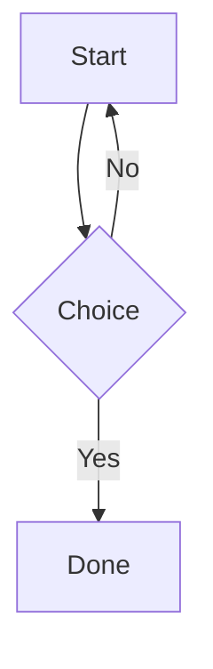
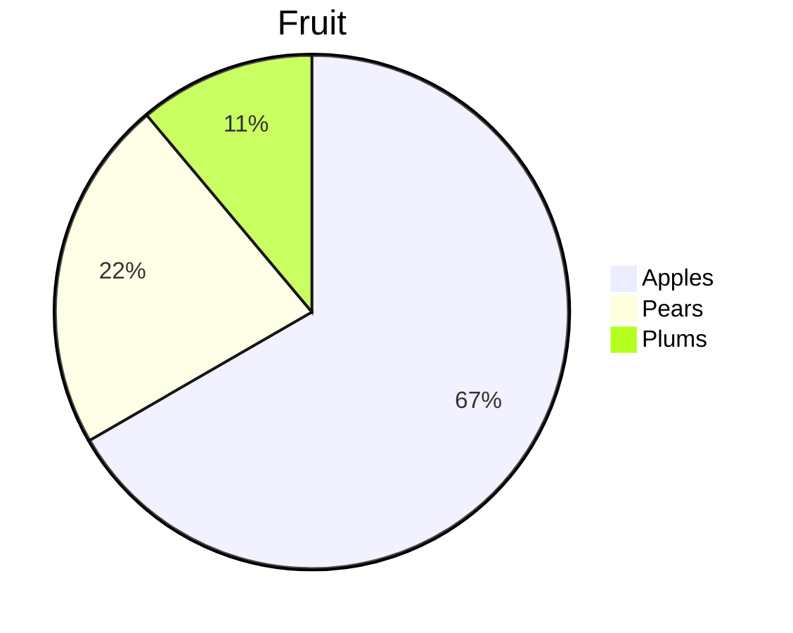
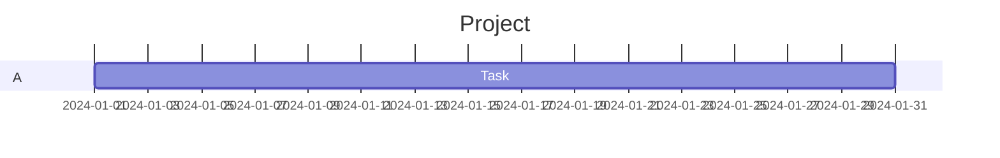

# Heading One

## Heading Two

### Heading Three

#### Heading Four

##### Heading Five

###### Heading Six

A plain paragraph of prose that is long enough to wrap across more than one line in a 680 point reading column, so the golden pins line height and paragraph spacing as well as the runs.

Inline styles: **bold**, *italic*, _underscore italic_, `inline code`, ~~strikethrough~~, a [link to the site](https://lineform.app), and an inline image  inside a sentence.

- Bulleted item one
- Bulleted item two with **bold**
  - Nested bullet
    - Doubly nested bullet

1. Numbered one
2. Numbered two
   1. Nested numbered
3. Numbered three

- [ ] Unchecked task
- [x] Checked task
  - [ ] Nested unchecked task
  - [x] Nested checked task

> A blockquote line with *emphasis*.
> A second blockquote line.

> [!NOTE]
> A note callout.

> [!TIP] Custom tip title
> A tip callout with a custom title.

> [!IMPORTANT]
> An important callout.

> [!WARNING]
> A warning callout.

> [!CAUTION]
> A caution callout.

```swift
struct Greeter {
    let name: String
    func greet() -> String { "Hello, \(name)!" } // comment
}
```

| Left | Center | Right |
|:-----|:------:|------:|
| a | b | 1 |
| A long cell whose text keeps going well past the width a content-sized column would want, so wrapping and fitting both show | centered | 22 |

---







Inline math $E = mc^2$ sits in a sentence, and so does \(a^2 + b^2 = c^2\).

$$
\int_0^1 x^2 \, dx = \frac{1}{3}
$$

$$
\frac{1}{
$$


The end.
