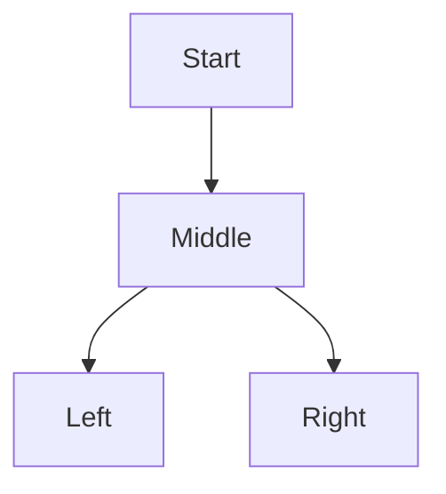

# The Harbor Notes

A short collection of notes with **bold words**, *italic words*, ~~struck words~~, `inline code`, and a [link to the site](https://lineform.app).

## Lists

- First bullet item
- Second bullet item with **emphasis**
  - Nested bullet item

1. First numbered item
2. Second numbered item
3. Third numbered item

- [ ] Open task on the list
- [x] Finished task on the list

## A Table

| Boat | Harbor | Length |
| :--- | :----: | -----: |
| Gull | North | 12 m |
| Heron | South | 9 m |
| Petrel | East | 15 m |

## Code

```swift
let greeting = "Hello, harbor"
print(greeting)
```

## Math

Inline math such as $x$ sits inside a sentence.

Before the first fraction.

$$\frac{1}{x}$$

After the first fraction. Before the wide fraction.

$$\frac{1}{x + y + z}$$

After the wide fraction.

## Diagram

Before the diagram.



After the diagram.

> [!NOTE]
> Callouts hold a short note for the reader.

## Prose

Every morning the harbor wakes slowly. The gulls circle the moored boats, the bakers open their shutters, and the first ferry sounds its horn across the gray water. Nobody hurries here, and the town seems to prefer it that way.

The old lighthouse keeper still walks the pier at dawn. He counts the boats, checks the knots, and writes a short note in a worn leather book. The notes are never long, but they are always honest, and over forty years they have become a quiet history of the coast.

Writing a long document is a lot like keeping that book. A sentence is added, then another, and the shape of the whole only appears after many small and patient steps. A calm page helps the writer see that shape.

In the afternoon the wind turns, and the market square fills with voices. Merchants call out prices for apples, cheese, and rope. Children chase each other between the stalls, and an old dog sleeps under a bench as if the noise were music.

The library on the hill keeps its doors open late. Its reading room has tall windows, wooden tables, and lamps with green shades. Students come to study, retired sailors come to read the newspapers, and now and then a traveler asks about the history of the town.

Plain text files last. A note written today can be opened in ten years by a different program on a different computer, and every word will still be there. That simple promise is worth more than any clever format.

When the evening comes, the harbor lights reflect on the water in long trembling lines. The boats rock gently, the taverns grow warm and loud, and the keeper climbs the stairs to light the lamp once more.

Some writers outline everything before they begin. Others start with a single image and follow it wherever it leads. Both methods work, and most people use a little of each, moving between plans and surprises as the draft grows.

Revision is where the real work happens. The first draft says what the writer thought; the second says what the writer meant. Reading the text aloud, slowly, is one of the best ways to hear where a sentence stumbles.

On Sundays the town holds a small concert in the park. A brass band plays old marches, a choir sings folk songs, and families spread blankets on the grass. The music drifts down to the water and mixes with the sound of the waves.

The fishermen tell stories about storms that lasted for days. They describe waves as tall as houses, masts that bent like reeds, and nights when the lighthouse was the only thing that kept them from the rocks.

A good paragraph has one job. It opens with a clear idea, supports it with detail, and closes in a way that leads to the next thought. When a paragraph tries to do two jobs, it usually does neither well.

The bakery on the corner makes bread the same way it did a century ago. The ovens are lit before sunrise, the dough rests in wooden boxes, and the loaves come out dark and crackling, ready for the morning crowd.

Long reading sessions need comfortable type. A generous line height, a moderate column width, and enough margin around the text all make it easier for the eye to travel from one line to the next without getting lost.

In winter the town grows quiet. Many shops close for the season, the ferry runs only twice a day, and fog rolls in from the sea most mornings. The people who stay know each other by name and share what they have.

Every story needs a reason to continue. A question, a problem, or a small mystery pulls the reader forward from one page to the next. Without that pull, even beautiful sentences start to feel heavy.

The keeper retired last spring, but he still visits the lighthouse every week. He brings his leather book, sits on the bench by the door, and writes a few lines about the weather, the boats, and the birds.

Editors often say that the best writing is invisible. The reader should notice the ideas, the people, and the places, not the words that carry them. Clear writing gets out of the way.

At the end of the season the town gathers for a festival. Lanterns hang from every window, musicians play on the steps of the church, and the whole harbor glows until long after midnight.

A document that lives as a plain file can travel anywhere. It can be copied, backed up, shared, and compared line by line. It belongs to the person who wrote it, and nothing stands between the writer and the words.

The new keeper is young and careful. She learned the routine from the old man, and now she writes her own notes in a new book, keeping the tradition alive while adding a few observations of her own.

Good tools stay quiet. They do their work without asking for attention, and they let the writer forget about them. The best compliment a tool can receive is that nobody thinks about it at all.
