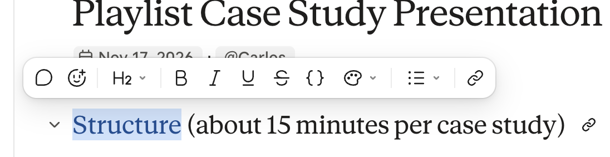
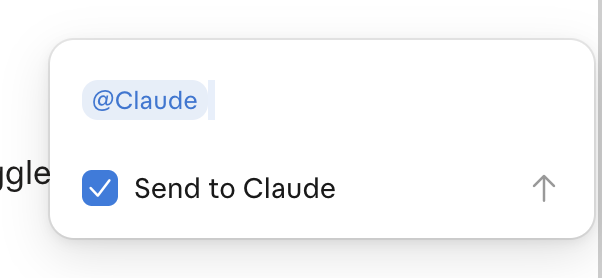

# Selection toolbar + "comment to AI" (future idea)

Noted 2026-11-17.

**Status: built 2026-11-17** (branch `feature/selection-toolbar`). The default action is named **Custom** (not "None", which read as "does nothing"). Implementation notes: `docs/architecture/editor-behavior.md` § Selection toolbar; mockup: `docs/superpowers/specs/2026-11-17-selection-toolbar-mockup.html`.

Reference: Claude Docs' selection UI.

## 1. A floating toolbar when text is selected

- It appears **as soon as text is selected**, with no right-click needed, floating just above the
  selection.
- One-click styling: heading level, bold, italic, underline, strikethrough, code, list, link
  (the same commands as the Format menu).
- Why: it is faster than right-click, then a submenu, then a command.

## 2. A comment button that talks to the connected AI

- It sits in the same toolbar, like the speech-bubble button in the reference.
- It **shows only when an AI is connected**. With no AI connected, the button is not there.
- The comment field shows the connected AI's name (like the `@Claude` chip in the reference).
- You type free-form context about the selection: "I don't like the vibe of this", "make it sound
  like X", "say it the way I'd say it to a friend".
- It replaces the current approach, where the spec's fixed right-click actions (Trim, Cut in half,
  Rewrite, Proofread, Mark weakest/long sentences) can't take your own direction.

### Action dropdown inside the comment

The comment box has a dropdown to choose an action, so the action and your context go together in
one request:

- **Custom** (default; first noted as "None"): only what you typed in the comment is sent.
- **Cut in half**, **Trim**, **Rewrite**, **Proofread**, **Mark weakest sentences**, etc. The chosen
  action runs, with your comment as extra direction.
  - For example, *Cut in half* + "keep the part about the budget".
  - For example, *Mark weakest sentences* + "and improve them so they sound stronger".

So you don't have to type "cut in half" yourself: you pick the action and add only the nuance.

## Decided

- Right-click stays as it is. The toolbar is an addition, not a replacement.
- The toolbar shows whenever text is selected. Selecting text means you aren't typing, so it never
  gets in the way of writing.
- It's in the editing view.
- It uses the app's existing styling and UI conventions, and adapts to light and dark mode like
  everything else. Nothing about it is styled differently.
