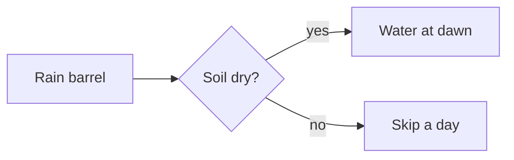

# Garden Notes

The beds by the fence get the last of the evening light, so this year the tomatoes move there and the lettuce takes the shady corner by the shed.

## This week

- Turn the compost and add the dry leaves from the path
- Sow a second row of radishes
- [x] Mend the gap in the netting
- [ ] Order *two* more rain barrels

## Watering plan

Each barrel holds about 200 litres. With a roof of area $A$ and rainfall $r$, the water collected is

$$
V = A \cdot r \cdot 0.9
$$

so a 20 m² roof fills one barrel after roughly 11 mm of rain.

> **Note:** water the seedlings by hand until their second leaves open.
